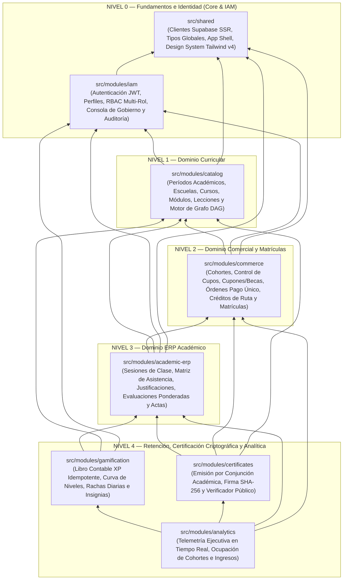

# NEXUS — Enterprise Hybrid Educational Platform (Commercial LMS + Academic ERP)


> [!IMPORTANT]
> **Resumen Ejecutivo**: **NEXUS** es una plataforma educativa empresarial multi-rol que unifica en una sola instancia el rigor normativo de un **ERP Académico Universitario** (períodos lectivos, cohortes con control de cupos, asistencia ponderada por sesión, detección temprana de deserción, libro de calificaciones ponderado y actas inmutables) con la conversión y retención de un **LMS Comercial Moderno** (checkout de pago único por curso o ruta curricular completa, grafos dirigidos acíclicos de prerrequisitos DAG, libro contable idempotente de experiencia XP y certificados verificables con firma criptográfica SHA-256).

---

## Tabla de Contenidos

1. [Arquitectura de Software y Jerarquía de Dependencias](#1-arquitectura-de-software-y-jerarquía-de-dependencias)
2. [Invariantes de Dominio y Reglas de Ingeniería](#2-invariantes-de-dominio-y-reglas-de-ingeniería)
3. [Motores Matemáticos y Algoritmos de Negocio](#3-motores-matemáticos-y-algoritmos-de-negocio)
4. [Arquitectura de Base de Datos (PostgreSQL 17, Indexación y RLS)](#4-arquitectura-de-base-de-datos-postgresql-17-indexación-y-rls)
5. [Mapa de Rutas y Módulos Productivos](#5-mapa-de-rutas-y-módulos-productivos)
6. [Estructura del Repositorio](#6-estructura-del-repositorio)
7. [Documentación Técnica y Gobernanza por Skills](#7-documentación-técnica-y-gobernanza-por-skills)
8. [Instalación, Verificación Deductiva y Despliegue](#8-instalación-verificación-deductiva-y-despliegue)

---

## 1. Arquitectura de Software y Jerarquía de Dependencias

El código fuente de **NEXUS** implementa una arquitectura **Modular Orientada a Dominios (Feature-First + Clean Domain Boundaries)** gobernada por un **Grafo Dirigido Acíclico (DAG) de 5 niveles de dependencia (Nivel 0 a Nivel 4)**.

> [!NOTE]
> **Ley de Dirección de Dependencias**: Un módulo perteneciente al Nivel $N$ únicamente puede importar contratos públicos expuestos por el archivo fachada `index.ts` de módulos en niveles inferiores ($< N$). Queda prohibida cualquier dependencia ascendente, circular o importación profunda hacia carpetas internas de otro módulo.



### Anatomía Interna de Cada Módulo de Dominio

Cada módulo dentro de `src/modules/<dominio>/` aísla estrictamente sus responsabilidades en cuatro capas internas más su fachada pública:

| Capa Interna | Responsabilidad Técnica | Restricciones de Acoplamiento |
| :--- | :--- | :--- |
| **`domain/`** | Entidades (`entities.ts`), fórmulas determinísticas puras (`rules.ts`) y errores tipados (`errors.ts`). | Cero dependencias de React, Next.js o clientes de base de datos. 100% testeable en memoria. |
| **`application/`** | Esquemas de validación `zod` (`schemas.ts`) y contratos de entrada/salida. | Depende únicamente de `domain/` y `zod`. |
| **`infrastructure/`** | Consultas optimizadas con proyección explícita de columnas (`queries.ts`) y mutaciones/RPC (`mutations.ts`). | Ejecución exclusiva en servidor (`'use server'`). Prohibido el uso de `.select('*')`. |
| **`presentation/`** | Server Actions tipadas con retorno discriminado `ActionResult<T>` (`actions.ts`) y vistas interactivas de cliente (`components/`). | Consume `domain/`, `application/` e `infrastructure/`. |
| **`index.ts`** | Fachada pública del módulo (*Barrel File*). | Único punto de entrada permitido para consumidores externos (`src/app/` o módulos de nivel superior). |

---

## 2. Invariantes de Dominio y Reglas de Ingeniería

El sistema hace cumplir **7 invariantes inquebrantables** tanto en la capa de dominio TypeScript como físicamente en el motor **PostgreSQL 17**:

1. **Metodología Deductiva desde Hechos Verificados**: Ninguna tabla, migración, función RPC o integración se declara operativa sin verificación empírica contra la instancia real de PostgreSQL mediante `npm run db:verify`.
2. **Seguridad Row Level Security (RLS) Obligatoria con `InitPlan` Caching**: Las **28 tablas** del esquema `public` tienen RLS activo. Todas las políticas encapsulan `(SELECT auth.uid())` y `(SELECT public.is_admin_or_coordinator())` como subconsultas escalares para que el planificador de PostgreSQL evalúe el token JWT una sola vez por consulta (*InitPlan*), evitando evaluaciones fila por fila.
3. **Integridad Acíclica de Prerrequisitos (DAG)**: Toda relación en `public.course_prerequisites` es validada antes de su inserción por un algoritmo de búsqueda en profundidad (DFS) en aplicación y por el trigger recursivo `trg_enforce_dag_no_cycles` (`WITH RECURSIVE`) en PostgreSQL.
4. **Invariante del Libro de Calificaciones ($\sum w_i = 100.00\%$)**: Una cohorte no puede ejecutar su cierre de acta si la suma de los pesos porcentuales (`weight_pct`) de sus rubros en `public.evaluation_items` difiere de `100.00%`.
5. **Inmutabilidad Física de Actas Cerradas**: Cuando una cohorte alcanza el estado `closed`, los triggers `trg_immutable_evaluation_items_on_closed`, `trg_immutable_submissions_on_closed` y `trg_immutable_attendance_on_closed` bloquean a nivel de motor cualquier `INSERT`, `UPDATE` o `DELETE` directo sobre notas y asistencias. Cualquier corrección posterior exige una solicitud formal en `public.grade_rectifications` aprobada por Coordinación y registrada en `public.audit_logs`.
6. **Conjunción Estricta de Certificación**: Un certificado verificable solo puede emitirse cuando se cumple simultáneamente la conjunción lógica de nota mínima aprobatoria, porcentaje mínimo de asistencia y orden de pago confirmada.
7. **Idempotencia Contable Anti-Farming en Gamificación**: El libro mayor `public.xp_ledger` impone la restricción única compuesta `UNIQUE (user_id, event_type, reference_id)`, garantizando físicamente que ninguna lección, asistencia o evaluación otorgue puntos XP duplicados.

---

## 3. Motores Matemáticos y Algoritmos de Negocio

### 3.1 Motor de Calificación Ponderada (`Gradebook Engine`)
Dada una cohorte con $N$ rubros de evaluación donde cada rubro $i$ posee un peso $w_i \in (0, 100]$ tal que $\sum_{i=1}^{N} w_i = 100.00\%$, y una calificación obtenida $S_i \in [0, 100]$, la nota final ponderada $G_{\text{final}}$ se define como:

$$G_{\text{final}} = \text{round}\left( \sum_{i=1}^{N} \left( S_i \times \frac{w_i}{100} \right), 2 \right)$$

### 3.2 Motor de Asistencia y Alerta Temprana de Deserción (`Early Warning System`)
Para una cohorte con $M_{\text{total}}$ sesiones programadas y $M_{\text{dictadas}}$ sesiones ya impartidas, cada registro de asistencia en la sesión $j$ asigna un factor de presencia $a_j \in \{1.0 \text{ (presente)}, 1.0 \text{ (justificado)}, 0.5 \text{ (tardanza)}, 0.0 \text{ (ausente)}\}$. El porcentaje de asistencia actual ($A_{\text{actual}}$) y el porcentaje máximo alcanzable ($A_{\text{máx}}$) asumiendo asistencia perfecta en las $M_{\text{restantes}} = M_{\text{total}} - M_{\text{dictadas}}$ sesiones restantes se calculan como:

$$A_{\text{actual}} = \left( \frac{\sum_{j=1}^{M_{\text{dictadas}}} a_j}{M_{\text{dictadas}}} \right) \times 100 \quad ; \quad A_{\text{máx}} = \left( \frac{\left(\sum_{j=1}^{M_{\text{dictadas}}} a_j\right) + M_{\text{restantes}}}{M_{\text{total}}} \right) \times 100$$

- Si $A_{\text{máx}} < A_{\text{mín}}$, el estado de riesgo pasa automáticamente a `critical_dropout_risk` (reprobación matemática inminente por inasistencia).
- Si $A_{\text{mín}} \le A_{\text{máx}} < A_{\text{mín}} + 5\%$, el estado pasa a `warning`.

### 3.3 Conjunción de Aprobación y Emisión Criptográfica SHA-256
Al cerrarse el acta de una cohorte, el dictamen de certificación se evalúa mediante:

$$\text{Certificable} \iff (G_{\text{final}} \ge G_{\text{mín}}) \land (A_{\text{final}} \ge A_{\text{mín}}) \land (\text{OrderStatus} = \texttt{'paid'})$$

Cada certificado aprobado genera un código público único (`NEX-YYYY-XXXXXXXX`) y un sello criptográfico inmutable:

$$\text{SignatureHash} = \texttt{sha256}\left( \text{VerificationCode} \parallel \text{DocumentID} \parallel \text{CourseCode} \parallel G_{\text{final}} \right)$$

### 3.4 Curva Progresiva de Niveles XP
El umbral de experiencia acumulada requerido para alcanzar el nivel $L$ ($L \ge 1$) sigue una progresión exponencial controlada:

$$\text{XP}_{\text{requerido}}(L) = \lfloor 100 \times (L - 1)^{1.5} \rfloor$$

---

## 4. Arquitectura de Base de Datos (PostgreSQL 17, Indexación y RLS)

El esquema productivo en Supabase cuenta con **28 tablas con Row Level Security activo**, **6 migraciones versionadas** y **6 funciones RPC en `PL/pgSQL`**:

| Nivel | Tablas en Esquema `public` | Índices Especializados y Triggers Activos |
| :-: | :--- | :--- |
| **Nivel 0 (IAM)** | `profiles`, `user_roles`, `audit_logs` | Índice cubriente `idx_user_roles_userid_covering_role INCLUDE (role)`, índices GIN Trigram (`pg_trgm`) sobre nombre/correo, índice GIN `jsonb_path_ops` sobre auditoría y triggers de sincronización de rol hacia `auth.users`. |
| **Nivel 1 (Catalog)** | `academic_terms`, `learning_paths`, `courses`, `learning_path_items`, `course_prerequisites`, `course_modules`, `lessons` | Trigger recursivo anti-ciclos `trg_enforce_dag_no_cycles`, índices parciales `WHERE is_published = true` e índices GIN Trigram para búsqueda instantánea en catálogo. |
| **Nivel 2 (Commerce)** | `cohorts`, `coupons`, `orders`, `order_items`, `enrollments`, `path_entitlements` | Restricción de capacidad `chk_cohorts_capacity`, índice parcial de revisión de Tesorería `WHERE payment_status = 'under_review'` y función RPC `fn_check_cohort_enrollment_eligibility`. |
| **Nivel 3 (ERP)** | `class_sessions`, `attendance_records`, `attendance_justifications`, `evaluation_items`, `submissions`, `grade_rectifications`, `lesson_progress` | Triggers de inmutabilidad en actas cerradas (`trg_immutable_*_on_closed`), índices cubrientes por cohorte/matrícula y función RPC `fn_get_cohort_erp_audit`. |
| **Nivel 4 (Engagement & BI)** | `user_gamification`, `xp_ledger`, `badges`, `user_badges`, `certificates` | Restricción anti-farming `uq_xp_ledger_idempotent`, índice cubriente $O(\log n)$ `idx_certificates_verification_lookup`, y funciones RPC `fn_calculate_level_from_xp`, `fn_verify_certificate_by_code` y `fn_get_executive_analytics_snapshot`. |

---

## 5. Mapa de Rutas y Módulos Productivos

La interfaz implementa el sistema de diseño **Luminous Alabaster (`#F3F5F9`), Liquid Platinum (`card-glass`) & Obsidian Ink (`#090B0F`)** con acento ámbar cálido (`#D97706`) en **Tailwind CSS v4**, cumpliendo con la política estricta de **Cero Emojis** (iconografía vectorial `lucide-react` 100%) y arquitectura responsive fluida mediante **Container Queries (`@container`)**, **Sidebar Icon Rail** y **Bottom Dock móvil**:

| Ruta App Router | Módulo / Nivel | Funcionalidad Principal |
| :--- | :--- | :--- |
| **`/`** | `catalog` (Nivel 1) | Portal de inicio, convocatoria académica `2027-I` con cuenta regresiva en tiempo real, acordeón de materias troncales y explorador de facultades con filtrado instantáneo. |
| **`/paths`** | `catalog` (Nivel 1) | Explorador interactivo de malla curricular DAG (`CS-101` a `ERP-401`), simulador de desbloqueo de prerrequisitos, visor de sílabo y laboratorio anti-ciclos. |
| **`/commerce`** | `commerce` (Nivel 2) | Selector de cohortes abiertas `2027-I`, dictamen pre-compra vía RPC `fn_check_cohort_enrollment_eligibility`, validador de cupones/becas (`NEXUS20`, `EARLY2027`, `BECA100`) y checkout. |
| **`/erp`** | `academic-erp` (Nivel 3) | Libro de calificaciones ponderado interactivo, auditoría de invariante $\sum w_i = 100\%$, matriz de asistencia por sesión (`P/T/A/J`), detector de riesgo de deserción y sellado inmutable de actas. |
| **`/progress`** | `gamification` (Nivel 4) | Gráfica semanal interactiva de estudio, indicadores de Kardex ERP (promedio ponderado y asistencia) y tabla de posición semanal (*Leaderboard*). |
| **`/verify`** y **`/verify/[code]`** | `certificates` (Nivel 4) | Verificador público criptográfico SHA-256 (`fn_verify_certificate_by_code`) para validación de diplomas (`VALID`, `REVOKED`, `NOT_FOUND`), curva de nivel XP y vitrina de insignias. |
| **`/analytics`** | `analytics` (Nivel 4) | Centro de comando ejecutivo alimentado en tiempo real por `fn_get_executive_analytics_snapshot()` (facturación estimada, ocupación de cupos y auditoría de los 5 niveles). |
| **`/profile`** | `iam` (Nivel 0) | Expediente estudiantil verificable, edición de identidad oficial con validación `zod` + Server Action y acceso directo a certificados emitidos. |
| **`/admin/users`** | `iam` (Nivel 0) | Consola de Gobierno RBAC para `super_admin` con búsqueda instantánea, filtrado por rol y asignación transaccional `rpc_assign_user_role` con actualización optimista (`useOptimistic`). |
| **`/login`** y **`/register`** | `iam` (Nivel 0) | Autenticación contra Supabase Auth y apertura de expediente estudiantil con sincronización automática de perfil y rol por triggers SQL. |

---

## 6. Estructura del Repositorio

```text
nexus/
├── .agents/                                  # Reglas y Skills especializadas de ingeniería asistida por IA
│   └── skills/
│       ├── nexus-deductive-verification/     # Verificación empírica obligatoria sobre infraestructura real
│       ├── nexus-architecture-guard/         # Control de niveles de dependencia (0 a 4) y contratos Clean/DDD
│       ├── nexus-supabase-dba/               # Estándares SQL, indexación INCLUDE/GIN y RLS con InitPlan
│       ├── nexus-academic-erp-engine/        # Fórmulas de notas ponderadas, asistencia, riesgo y actas
│       ├── nexus-gamification-certs/         # Ledger XP idempotente, rachas y certificados SHA-256
│       └── nexus-ui-design-system/           # Estándares Tailwind CSS v4 (Luminous Alabaster & Obsidian Ink, Cero Emojis)
├── docs/                                     # Documentación maestra de arquitectura y negocio (00 al 07)
├── scripts/
│   └── verify-supabase.mjs                   # Suite de auditoría E2E de las 28 tablas y funciones RPC
├── supabase/
│   ├── migrations/                           # 6 migraciones SQL secuenciales (Fases 2 a 7)
│   └── seed.sql                              # Datos curriculares, cohortes, sesiones, rubros y certificados
├── src/
│   ├── app/                                  # Next.js 15 App Router (Layouts, Server Components, Rutas)
│   │   ├── (auth)/                           # /login y /register
│   │   ├── (dashboard)/                      # /, /paths, /commerce, /erp, /progress, /verify, /analytics, /profile, /admin/users
│   │   ├── globals.css                       # Configuración CSS-first (@theme) de Tailwind CSS v4
│   │   └── layout.tsx                        # Root Layout
│   ├── modules/                              # Módulos de dominio desacoplados por niveles (Niveles 0 al 4)
│   │   ├── iam/                              # [Nivel 0] Identidad, Perfiles y RBAC
│   │   ├── catalog/                          # [Nivel 1] Períodos, Cursos, Módulos y Motor DAG
│   │   ├── commerce/                         # [Nivel 2] Cohortes, Cupones, Órdenes y Matrículas
│   │   ├── academic-erp/                     # [Nivel 3] Sesiones, Asistencia, Evaluaciones y Actas
│   │   ├── gamification/                     # [Nivel 4] XP Ledger, Niveles, Rachas e Insignias
│   │   ├── certificates/                     # [Nivel 4] Certificados Verificables SHA-256
│   │   └── analytics/                        # [Nivel 4] Telemetría Ejecutiva y KPIs
│   ├── shared/                               # [Nivel 0] Clientes Supabase SSR, Tipos Generados y App Shell
│   └── middleware.ts                         # Guard RBAC y refresco de sesión JWT en Edge
└── AGENTS.md                                 # Contexto permanente y reglas inquebrantables del repositorio
```

---

## 7. Documentación Técnica y Gobernanza por Skills

Toda decisión arquitectónica, matemática y de diseño se encuentra documentada en [`/docs`](./docs):

| Código | Documento Técnico | Alcance |
| :-: | :--- | :--- |
| **00** | [**Contexto del Proyecto y Catálogo de Skills**](./docs/00-CONTEXTO-Y-SKILLS.md) | Metodología de trabajo, glosario oficial (*Ubiquitous Language*) y activación de las 6 Skills en `.agents/skills/`. |
| **01** | [**Modelo de Negocio, Monetización y Matriz RBAC**](./docs/01-MODELO-DE-NEGOCIO-Y-ROLES.md) | Propuesta de valor híbrida, flujos de pago único/tesorería y matriz completa de permisos para los 4 roles. |
| **02** | [**Arquitectura de Software y Diagramas de Dependencias**](./docs/02-ARQUITECTURA-Y-DEPENDENCIAS.md) | Diseño en capas, grafo acíclico de módulos (Niveles 0 a 4) y desacoplamiento transaccional. |
| **03** | [**Esquema de Base de Datos (ERD), Diccionario y RLS**](./docs/03-ESQUEMA-BASE-DE-DATOS-Y-RLS.md) | Diagramas Entidad-Relación por dominio, tipos `ENUM`, índices y políticas Row Level Security. |
| **04** | [**Diagramas de Procesos y Máquinas de Estado**](./docs/04-DIAGRAMAS-DE-PROCESOS-Y-FLUJOS.md) | Diagramas de secuencia de extremo a extremo y máquinas de estado (`cohort_status`, `order_status`, `enrollment_status`). |
| **05** | [**Diagramas de Funcionalidad y Lógica de Motores**](./docs/05-LOGICA-FUNCIONAL-Y-MOTORES.md) | Especificación algorítmica de los motores DAG, Gradebook, Gamificación Anti-Farming y Certificados SHA-256. |
| **06** | [**Roadmap de Ingeniería por Fases**](./docs/06-ROADMAP-POR-FASES.md) | Registro histórico y verificación empírica de las 7 fases de construcción del sistema. |
| **07** | [**Sistema de Diseño, Layout Responsive y UX/UI**](./docs/07-SISTEMA-DE-DISENO-Y-UX-UI.md) | Especificación visual *Luminous Alabaster, Liquid Platinum & Obsidian Ink*, iconografía vectorial SVG y arquitectura responsive con Container Queries. |

---

## 8. Instalación, Verificación Deductiva y Despliegue

### 8.1 Variables de Entorno Requeridas (`.env.local`)
```env
NEXT_PUBLIC_SUPABASE_URL=https://<project-ref>.supabase.co
NEXT_PUBLIC_SUPABASE_ANON_KEY=<anon-jwt-key>
NEXT_PUBLIC_SUPABASE_PUBLISHABLE_KEY=sb_publishable_<key>
NEXT_PUBLIC_APP_URL=http://localhost:3000
```

### 8.2 Comandos de Ingeniería y Auditoría

```bash
# 1. Instalar dependencias del proyecto
npm install

# 2. Ejecutar auditoría deductiva E2E contra Supabase PostgreSQL (28 tablas RLS + RPCs en vivo)
npm run db:verify

# 3. Verificar tipado estático estricto en TypeScript (strict: true, cero any)
npm run typecheck

# 4. Iniciar servidor de desarrollo en http://localhost:3000
npm run dev

# 5. Compilar versión optimizada de producción
npm run build
```

---

## Estado de Fases de Ingeniería (Verificado en Producción)

- [x] **Fase 1**: Arquitectura, Modelo de Negocio, Esquemas ERD, Diagramas de Procesos, Sistema de Diseño y Agent Skills.
- [x] **Fase 2**: Fundación Técnica, Autenticación Multi-Rol (IAM Nivel 0), Consola RBAC y Design System en Tailwind CSS v4.
- [x] **Fase 3**: Dominio Curricular (Catálogo Nivel 1), Módulos, Lecciones y Motor de Grafo de Prerrequisitos (DAG) con trigger anti-ciclos.
- [x] **Fase 4**: Motor Comercial (Nivel 2), Apertura de Cohortes `2027-I`, Cupones/Becas, Checkout y Validador RPC Pre-Matrícula.
- [x] **Fase 5**: Motor ERP Académico (Nivel 3), Sesiones de Clase, Matriz de Asistencia, Calificaciones Ponderadas y Bloqueo de Actas Cerradas.
- [x] **Fase 6**: Motor de Gamificación Anti-Farming (`xp_ledger`, Curva de Niveles, Insignias) y Certificados Criptográficos SHA-256 (`/verify/[code]`).
- [x] **Fase 7**: Centro de Comando de Analítica Ejecutiva (`/analytics`), Telemetría RPC en Tiempo Real y Suite de Verificación E2E (`npm run db:verify`).
