# 00 — Contexto Maestro del Proyecto y Catálogo de Skills

> **Propósito de este documento**: Servir como punto de entrada cognitivo para desarrolladores y agentes de IA a lo largo de todos los meses de construcción de **Nexus**. Explica cómo está organizado el conocimiento del proyecto, cómo operan las reglas automáticas (`AGENTS.md`) y cuándo activar cada una de las 6 **Skills** del workspace.

---

## 1. Filosofía de Desarrollo a Largo Plazo (Multi-Mes)

Un sistema que combina un **ERP Académico** con un **LMS Comercial Gamificado** fracasa si se intenta programar de forma monolítica o improvisada. Por ello, **Nexus** se rige por cuatro principios de ingeniería:

1. **Documentación Primero (Docs-Driven Development)**: Ninguna tabla, endpoint o pantalla se programa sin estar definida en los documentos `01` al `07` de `/docs`.
2. **Modularidad Estricta por Dominios**: El sistema se divide en módulos independientes (`iam`, `catalog`, `commerce`, `academic-erp`, `gamification`, `certificates`, `analytics`) gobernados por un grafo acíclico de dependencias (Niveles 0 al 4).
3. **Integridad en la Base de Datos (Database-First Invariants)**: Los cálculos financieros, los promedios ponderados de calificaciones, los umbrales de asistencia, la idempotencia del XP y los bloqueos de actas viven en **PostgreSQL (Supabase)** mediante funciones transaccionales y políticas **RLS**, nunca confiando ciegamente en el cliente.
4. **Memoria Persistente para IA (Context & Skills)**: Cualquier sesión de trabajo futura carga automáticamente las reglas de [`AGENTS.md`](../AGENTS.md) y dispone de skills especializadas en [`.agents/skills/`](../.agents/skills/).

---

## 2. Arquitectura del Contexto y Skills del Proyecto

```mermaid
flowchart LR
    subgraph Contexto["Memoria Siempre Activa"]
        AGENTS["AGENTS.md (Reglas Globales e Invariantes)"]
        README["README.md (Índice Maestro del Proyecto)"]
    end

    subgraph Skills["Skills Bajo Demanda (.agents/skills/)"]
        S0["nexus-deductive-verification"]
        S1["nexus-architecture-guard"]
        S2["nexus-supabase-dba"]
        S3["nexus-academic-erp-engine"]
        S4["nexus-gamification-certs"]
        S5["nexus-ui-design-system"]
    end

    subgraph Docs["Especificaciones Profundas (/docs)"]
        D1["01. Modelo de Negocio y RBAC"]
        D2["02. Arquitectura y Dependencias"]
        D3["03. Esquema BD (ERD) y RLS"]
        D4["04. Diagramas de Procesos"]
        D5["05. Lógica Funcional y Motores"]
        D6["06. Roadmap por Fases"]
        D7["07. Sistema de Diseño y UX/UI"]
    end

    Contexto --> Skills
    Skills --> Docs
```

---

## 3. Catálogo de Skills del Proyecto y Cuándo Usarlas

Cada skill en `.agents/skills/<nombre>/SKILL.md` está diseñada con **divulgación progresiva** para que el agente la active automáticamente según la tarea de la fase en curso:

| Skill | Ruta | Cuándo se activa | Documentos Asociados |
| :--- | :--- | :--- | :--- |
| **`nexus-deductive-verification`** | [`.agents/skills/nexus-deductive-verification/SKILL.md`](../.agents/skills/nexus-deductive-verification/SKILL.md) | **Siempre activa conceptualmente.** Antes de afirmar que una tabla, integración o fase está lista, verifica los hechos reales (existencia de proyecto Supabase, `.env.local`, ejecución real de SQL) sin inducir ni usar mocks engañosos. | [`AGENTS.md`](../AGENTS.md), [`06-ROADMAP-POR-FASES.md`](./06-ROADMAP-POR-FASES.md) |
| **`nexus-architecture-guard`** | [`.agents/skills/nexus-architecture-guard/SKILL.md`](../.agents/skills/nexus-architecture-guard/SKILL.md) | Al crear nuevos módulos en `src/modules/`, definir Server Actions, validar esquemas Zod o estructurar rutas en `src/app/`. | [`02-ARQUITECTURA-Y-DEPENDENCIAS.md`](./02-ARQUITECTURA-Y-DEPENDENCIAS.md) |
| **`nexus-supabase-dba`** | [`.agents/skills/nexus-supabase-dba/SKILL.md`](../.agents/skills/nexus-supabase-dba/SKILL.md) | Al escribir migraciones SQL, crear tablas, definir políticas RLS por rol o programar funciones RPC en `PL/pgSQL`. | [`03-ESQUEMA-BASE-DE-DATOS-Y-RLS.md`](./03-ESQUEMA-BASE-DE-DATOS-Y-RLS.md) |
| **`nexus-academic-erp-engine`** | [`.agents/skills/nexus-academic-erp-engine/SKILL.md`](../.agents/skills/nexus-academic-erp-engine/SKILL.md) | Al implementar cohortes, prerrequisitos DAG, toma de asistencia, alertas de deserción, libro de calificaciones o cierre/rectificación de actas. | [`04-DIAGRAMAS-DE-PROCESOS-Y-FLUJOS.md`](./04-DIAGRAMAS-DE-PROCESOS-Y-FLUJOS.md), [`05-LOGICA-FUNCIONAL-Y-MOTORES.md`](./05-LOGICA-FUNCIONAL-Y-MOTORES.md) |
| **`nexus-gamification-certs`** | [`.agents/skills/nexus-gamification-certs/SKILL.md`](../.agents/skills/nexus-gamification-certs/SKILL.md) | Al implementar el libro mayor `xp_ledger`, niveles, rachas diarias, insignias, rankings por cohorte o emisión/verificación de certificados. | [`05-LOGICA-FUNCIONAL-Y-MOTORES.md`](./05-LOGICA-FUNCIONAL-Y-MOTORES.md) |
| **`nexus-ui-design-system`** | [`.agents/skills/nexus-ui-design-system/SKILL.md`](../.agents/skills/nexus-ui-design-system/SKILL.md) | Al diseñar o maquetar vistas con React y Tailwind CSS v4 (`@theme`), grillas de notas, matrices de asistencia o dashboards por rol. | [`01-MODELO-DE-NEGOCIO-Y-ROLES.md`](./01-MODELO-DE-NEGOCIO-Y-ROLES.md), [`06-ROADMAP-POR-FASES.md`](./06-ROADMAP-POR-FASES.md) |

---

## 4. Glosario Oficial del Dominio (Ubiquitous Language)

Para mantener consistencia absoluta entre la base de datos, el código TypeScript y la interfaz de usuario, todo el proyecto utiliza estos términos estándar:

| Término en Negocio (ES) | Identificador en Código / BD (EN) | Definición Exacta en Nexus |
| :--- | :--- | :--- |
| **Período Académico** | `AcademicTerm` / `academic_terms` | Ventana temporal institucional (ej. `2027-I`, `Verano 2027`) dentro de la cual se abren cohortes. |
| **Ruta de Aprendizaje** | `LearningPath` / `learning_paths` | Programa curricular compuesto por múltiples cursos ordenados mediante un grafo dirigido acíclico (DAG) de prerrequisitos. |
| **Curso / Materia** | `Course` / `courses` | Unidad curricular del catálogo con sílabo, módulos, lecciones, créditos, nota mínima aprobatoria y % mínimo de asistencia. |
| **Cohorte / Sección** | `Cohort` / `cohorts` | Instancia viva de un `Course` dictada en un `AcademicTerm` por un `Instructor` con cupo máximo, calendario de sesiones y libro de notas propio. |
| **Matrícula** | `Enrollment` / `enrollments` | Vínculo formal y financiero de un `Student` con una `Cohort` específica. Almacena su promedio final, % de asistencia y estado académico. |
| **Rubro de Evaluación** | `EvaluationItem` / `evaluation_items` | Actividad calificable dentro de una cohorte (Parcial, Quiz, Proyecto) con un peso porcentual `weight_pct` sobre el 100% de la nota. |
| **Entrega / Calificación** | `Submission` / `submissions` | Registro de la entrega de un estudiante para un `EvaluationItem` junto con la nota asignada (`0-100`) y el feedback del instructor. |
| **Sesión de Clase** | `ClassSession` / `class_sessions` | Clase sincrónica o presencial programada en el calendario de una cohorte sobre la cual se toma asistencia. |
| **Acta de Rectificación** | `GradeRectification` / `grade_rectifications` | Solicitud auditada para modificar una calificación después de que la cohorte ha sido cerrada (`closed`), aprobada por un `Coordinator`. |
| **Libro Mayor de XP** | `XpLedger` / `xp_ledger` | Registro transaccional e idempotente de cada punto de experiencia ganado por un estudiante. |
