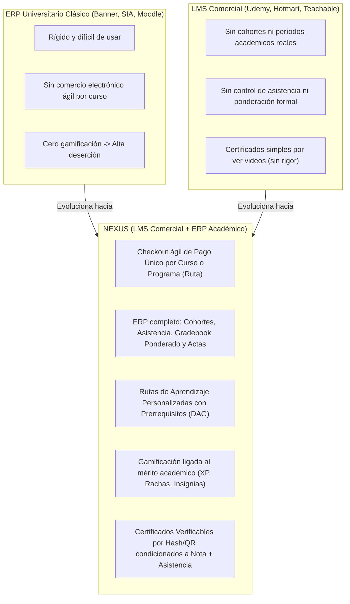
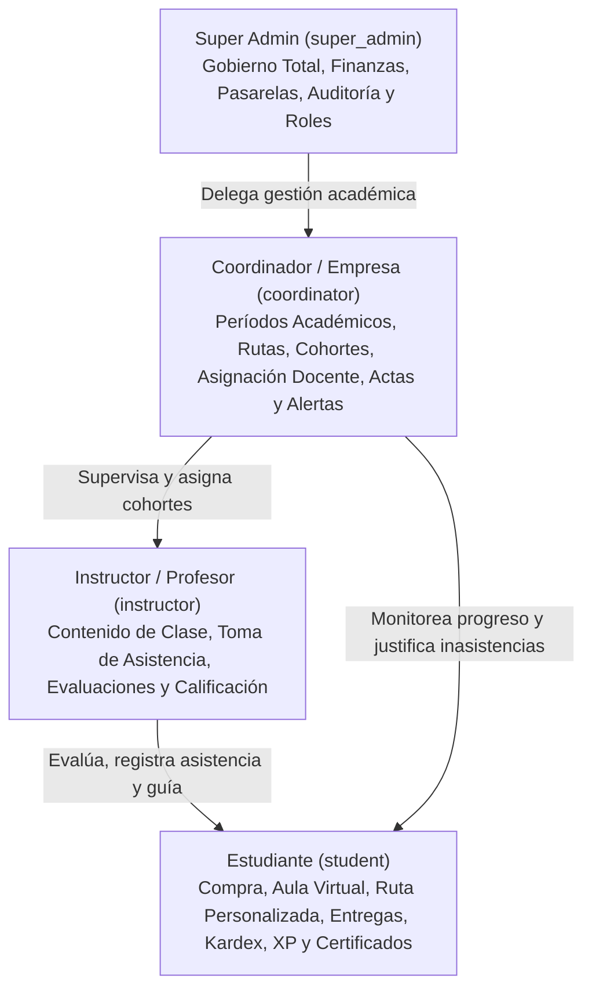

# 01 — Modelo de Negocio, Monetización y Matriz RBAC

> **Enfoque del Producto**: **Nexus** es una plataforma educativa híbrida (**LMS + ERP Académico**) con estructura **Multi-Rol en una sola instancia**, monetizada mediante la **venta individual de cursos y programas completos (rutas de aprendizaje)** y diferenciada por su control académico riguroso, rutas personalizadas, gamificación y certificados verificables.

---

## 1. Propuesta de Valor y Diferenciación Competitiva

---

## 2. Modelo de Monetización y Flujos de Ingresos

El modelo financiero se basa en **Venta Individual (Pago Único)** con tres modalidades comerciales complementarias:

### 2.1 Productos Comercializables
1. **Curso Individual (`Single Course Purchase`)**:
   - El estudiante compra un curso específico y selecciona la **Cohorte** disponible (con fecha de inicio, horario y profesor asignado).
   - Incluye acceso perpetuo al material asincrónico del curso + derecho a cursar la cohorte elegida, ser evaluado y obtener el certificado del curso.
2. **Programa / Ruta de Aprendizaje Completa (`Learning Path Bundle`)**:
   - El estudiante adquiere una ruta curricular completa (ej. *"Diplomado en Ingeniería de Software Full-Stack"* compuesto por 6 cursos secuenciales) con un descuento porcentual frente a comprar cada curso por separado.
   - Al comprar la ruta, el sistema le otorga **Créditos de Matrícula de Ruta (`path_enrollment_entitlements`)** que el estudiante va activando cohorte por cohorte a medida que aprueba los prerrequisitos.
3. **Derecho de Segunda Matrícula / Recuperación (`Retake Fee`)**:
   - Si un estudiante reprueba una cohorte por nota o inasistencia, puede adquirir el derecho de recursar en una nueva cohorte a una tarifa preferencial configurada por la institución.

### 2.2 Métodos de Pago Soportados en el Modelo
Para adaptarse tanto a compradores digitales como a estudiantes universitarios/institucionales:
- **Pago Instantáneo Online**: Tarjeta de crédito/débito o billeteras vía **Stripe / MercadoPago** (confirmación automática por Webhook).
- **Pago por Transferencia / Comprobante Bancario (Flujo de Tesorería)**: El estudiante sube el comprobante de depósito; la orden queda en estado `under_review` hasta que un `super_admin` o `coordinator` la aprueba en el panel financiero, disparando la misma función transaccional de matrícula.
- **Becas y Cupones (`Coupons & Scholarships`)**: Descuentos porcentuales o del 100% auditados.

---

## 3. Arquitectura de Roles y Permisos (RBAC Multi-Rol)

El sistema opera sobre una sola plataforma unificada con 4 roles jerárquicos y funcionales bien delimitados:

### 3.1 Matriz Detallada de Permisos por Módulo (CRUD + Acciones Especiales)

| Dominio / Funcionalidad | `super_admin` | `coordinator` | `instructor` | `student` |
| :--- | :-: | :-: | :-: | :-: |
| **1. IAM y Usuarios** | | | | |
| Gestionar roles y permisos de staff | Total | Sin acceso | Sin acceso | Sin acceso |
| Ver directorio de profesores y alumnos | Total | Total | Solo sus cohortes | Sin acceso |
| **2. Catálogo y Rutas (DAG)** | | | | |
| Crear/editar períodos académicos (`academic_terms`) | Total | Total | Lectura | Lectura |
| Crear/editar cursos, precios y prerrequisitos | Total | Total | Lectura | Catálogo público |
| Gestionar módulos y lecciones de un curso | Total | Total | Cursos asignados | Si está matriculado |
| Armar Rutas de Aprendizaje (`learning_paths`) | Total | Total | Lectura | Progreso propio |
| **3. Comercio y Matrículas** | | | | |
| Comprar cursos / rutas de aprendizaje | Sin acceso | Sin acceso | Sin acceso | Propio |
| Aprobar comprobantes de pago manual / becas | Total | Si autorizado | Sin acceso | Sin acceso |
| Procesar reembolsos (`refunds`) | Total | Sin acceso | Sin acceso | Sin acceso |
| Matricular o retirar alumnos manualmente | Total | Total | Sin acceso | Sin acceso |
| **4. ERP Académico (Cohortes, Notas, Asistencia)** | | | | |
| Crear cohortes, cupos y asignar instructor | Total | Total | Sus cohortes | Cohortes abiertas |
| Configurar rubros y pesos de evaluación ($\sum = 100\%$) | Total | Total | Sus cohortes activas | Sus cohortes |
| Tomar asistencia por sesión (`present`, `late`, `absent`) | Total | Total | Sus cohortes activas | Su asistencia |
| Aprobar justificaciones de inasistencia (`excused`) | Total | Total | Puede solicitar | Puede solicitar |
| Entregar tareas / presentar quizzes (`submissions`) | Sin acceso | Sin acceso | Sin acceso | Sus cohortes activas |
| Calificar entregas y dar retroalimentación | Total | Total | Sus cohortes activas | Sus propias notas |
| Cerrar Acta de Cohorte (`status = closed`) | Total | Total | Solicitar cierre | Sin acceso |
| Aprobar Rectificación de Nota en Acta Cerrada | Total | Total | Solo solicitar | Sin acceso |
| **5. Gamificación y Certificados** | | | | |
| Configurar reglas de XP e insignias (`badges`) | Total | Total | Lectura | Lectura |
| Ganar XP, mantener rachas y competir en ranking | Sin acceso | Sin acceso | Sin acceso | Propio / Cohorte |
| Descargar y compartir certificados verificables | Auditoría | Auditoría | Sus graduados | Propios |
| Revocar un certificado emitido (con causa auditada) | Total | Sin acceso | Sin acceso | Sin acceso |

---

## 4. Indicadores Clave de Rendimiento (KPIs del Modelo de Negocio)

El módulo `analytics` medirá el éxito del sistema a través de dos tableros:

### 4.1 KPIs Académicos (Para Coordinadores e Instructores)
- **Tasa de Aprobación por Cohorte (`Pass Rate`)**: % de matriculados que superan simultáneamente `min_passing_grade` y `min_attendance_pct`.
- **Índice de Alerta Temprana de Deserción (`At-Risk Students`)**: Alumnos cuya asistencia máxima proyectada está a menos de 5 puntos porcentuales del límite de reprobación o con promedio parcial $< 60\%$.
- **Tiempo Promedio de Retroalimentación Docente (`Grading SLA`)**: Horas promedio entre la entrega del alumno y la calificación del instructor.

### 4.2 KPIs Comerciales y de Retención (Para Super Admin)
- **Ingresos por Curso vs. Ingresos por Ruta Completa (`Bundle Share`)**.
- **Tasa de Continuidad en Ruta (`Path Progression Rate`)**: % de alumnos que, tras aprobar el Curso $N$, se matriculan o activan el Curso $N+1$ de su ruta.
- **Correlación Racha vs. Aprobación**: Impacto de las rachas de gamificación ($\ge 7$ días) en la tasa de finalización de cursos.
