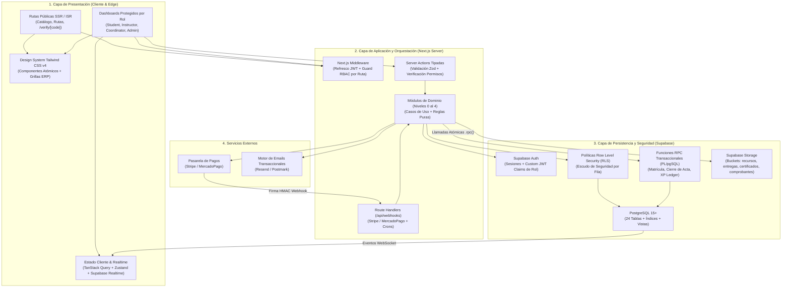
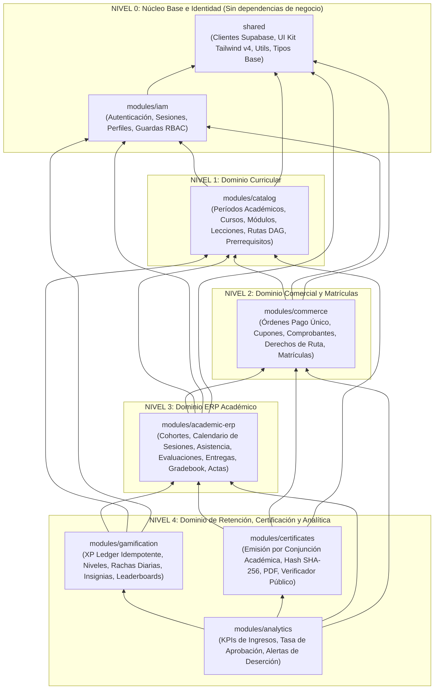
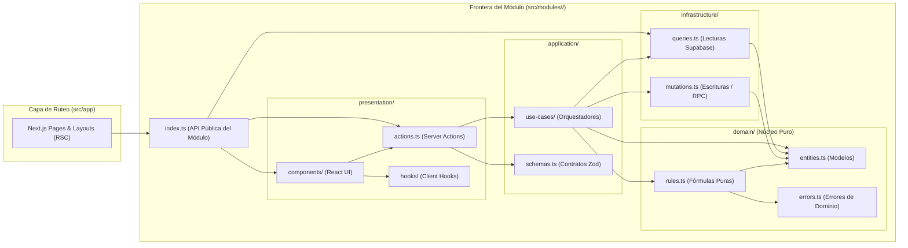
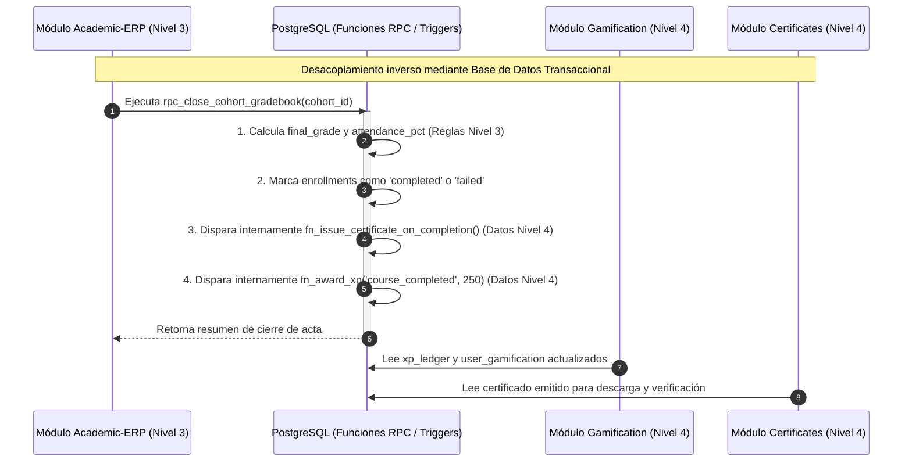

# 02 — Arquitectura de Software y Diagramas de Dependencias

> **Propósito de este documento**: Especificar la arquitectura técnica de **Nexus**, sus capas, el diseño modular orientado a dominios (*Feature-Sliced + Clean Domain Boundaries*), los diagramas de dependencias entre módulos, componentes e infraestructura, y los flujos de datos entre **Next.js (App Router)** y **Supabase**.

---

## 1. Arquitectura General del Sistema (Alto Nivel)

Nexus utiliza una arquitectura moderna **Server-First** apalancada en **Next.js App Router**, **React Server Components (RSC)**, **Server Actions** tipadas con **TypeScript** y **Supabase** como plataforma unificada de datos, identidad, seguridad a nivel de fila (RLS), almacenamiento y eventos en tiempo real.

---

## 2. Diagrama de Dependencias entre Módulos de Dominio (DAG Arquitectónico)

Para que el proyecto escale durante meses sin convertirse en código espagueti, todos los módulos en `src/modules/` obedecen una **jerarquía de 5 niveles (Nivel 0 a Nivel 4)**.

> **Regla Estricta de Compilación**: Las flechas en el siguiente diagrama significan **"depende de / importa de"**. Todas las flechas apuntan hacia abajo (hacia niveles inferiores). **Queda estrictamente prohibido cualquier ciclo o flecha hacia arriba.**

---

## 3. Diagrama de Dependencias Internas de un Módulo (Clean Feature Architecture)

Dentro de cada módulo (ej. `src/modules/academic-erp/`), las capas internas también siguen la **Regla de Dependencia Limpia**: la lógica de negocio (`domain`) no conoce ni a React ni a Supabase.

### ¿Por qué esta separación interna es vital para un proyecto de varios meses?
1. **Pruebas Unitarias Instantáneas (`domain/rules.ts`)**: Podemos probar todas las fórmulas de cálculo de notas ponderadas, porcentajes de asistencia, validación de grafos de prerrequisitos y curvas de XP en milisegundos con `Vitest`, sin necesidad de levantar la base de datos ni el navegador.
2. **Desacoplamiento de UI (`presentation/` vs `application/`)**: Si mañana cambia el diseño de una pantalla en Tailwind v4, las reglas de negocio y validaciones Zod en `application/` permanecen intactas.
3. **Contratos Claros (`index.ts`)**: Ningún otro módulo puede tocar las tripas privadas de `infrastructure/` de otro dominio.

---

## 4. Diagrama de Dependencias de Datos y Eventos Entre Módulos

Aunque `AcademicERP` (Nivel 3) **no puede importar código** de `Gamification` o `Certificates` (Nivel 4), cuando un estudiante entrega una tarea o aprueba una cohorte, los módulos de Nivel 4 deben reaccionar. Esto se resuelve mediante **Triggers / Funciones Transaccionales en PostgreSQL** y **Orquestadores de Nivel Superior**, manteniendo el acoplamiento en cero:

---

## 5. Estrategia de Caché, Renderizado y Seguridad en Next.js + Supabase

| Tipo de Ruta / Vista | Estrategia de Renderizado | Mecanismo de Seguridad | Invalidación de Datos |
| :--- | :--- | :--- | :--- |
| **Catálogo de Cursos y Rutas** (`/courses`, `/paths`) | **ISR / Server Components** con caché etiquetado (`use cache` / `revalidateTag('catalog')`) | Lectura pública (`is_published = true` en RLS) | Al publicar o editar un curso desde Coordinación/Admin |
| **Verificador de Certificados** (`/verify/[code]`) | **SSR Dinámico** con cabeceras SEO / OpenGraph | Función RPC pública de solo lectura limitada por `verification_code` | Inmediata si un certificado se emite o revoca |
| **Aula Virtual del Estudiante** (`/student/...`) | **SSR Dinámico + Streaming (`<Suspense>`)** | Middleware verifica rol + RLS verifica `student_id = auth.uid()` y matrícula `active` | `revalidatePath` tras completar lección o entregar evaluación |
| **Libro de Calificaciones y Asistencia** (`/instructor/...`) | **SSR + Estado Optimista en Cliente (`useOptimistic`)** | RLS verifica `cohort.instructor_id = auth.uid()` y `cohort.status != 'closed'` | Mutación por celda o por lote vía Server Action |
| **Webhooks de Pago** (`/api/webhooks/payments`) | **Route Handler (`POST`)** | Verificación criptográfica de firma (`Stripe-Signature` / HMAC) + Cliente Supabase `Service Role` | Transacción atómica en base de datos |
