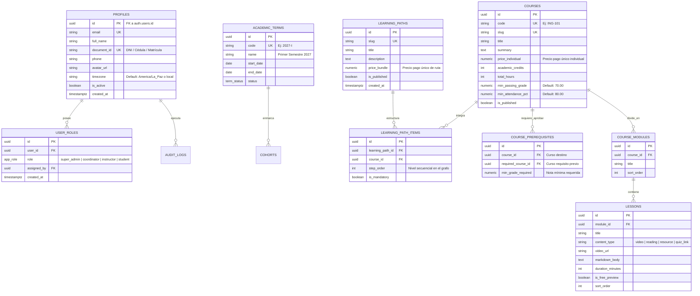
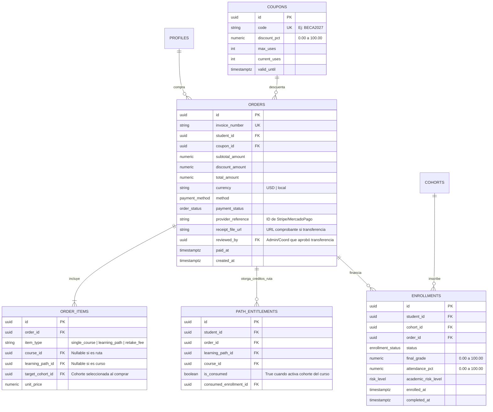
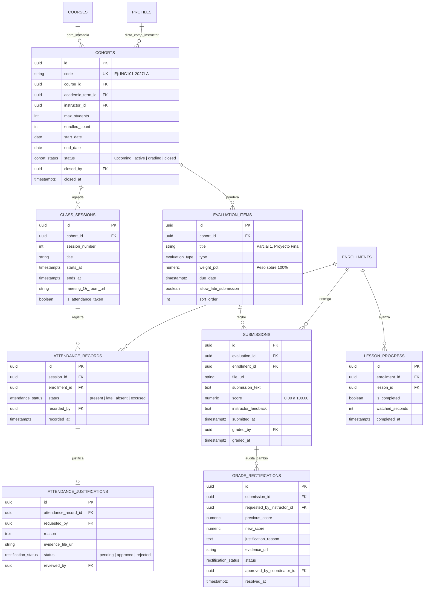

# 03 — Esquema de Base de Datos (ERD), Diccionario de Tablas y Seguridad RLS

> **Propósito de este documento**: Definir el modelo de datos completo en **PostgreSQL (Supabase)** para **Nexus**, dividido en 4 diagramas Entidad-Relación (ERD) por dominio, el diccionario de las **24 tablas del sistema**, sus tipos enumerados (`ENUMs`), índices críticos y las políticas de seguridad **Row Level Security (RLS)**.

---

## 1. Tipos Enumerados Globales (`PostgreSQL ENUMs`)

Antes de crear las tablas, el esquema define tipos enumerados estrictos para garantizar integridad referencial:

```sql
CREATE TYPE app_role AS ENUM ('super_admin', 'coordinator', 'instructor', 'student');
CREATE TYPE term_status AS ENUM ('planning', 'enrollment_open', 'in_progress', 'closed');
CREATE TYPE cohort_status AS ENUM ('upcoming', 'active', 'grading', 'closed', 'cancelled');
CREATE TYPE order_status AS ENUM ('pending', 'under_review', 'paid', 'failed', 'refunded');
CREATE TYPE payment_method AS ENUM ('stripe', 'mercadopago', 'bank_transfer', 'scholarship');
CREATE TYPE enrollment_status AS ENUM ('active', 'completed', 'failed_grade', 'failed_attendance', 'dropped');
CREATE TYPE risk_level AS ENUM ('normal', 'warning', 'critical_dropout_risk');
CREATE TYPE attendance_status AS ENUM ('present', 'late', 'absent', 'excused');
CREATE TYPE evaluation_type AS ENUM ('exam', 'quiz', 'assignment', 'project', 'participation');
CREATE TYPE rectification_status AS ENUM ('pending', 'approved', 'rejected');
```

---

## 2. Diagramas Entidad-Relación (ERD) por Dominio

### 2.1 Dominio 1: Identidad (IAM) y Catálogo Curricular (Rutas DAG y Cursos)



### 2.2 Dominio 2: Comercio (Órdenes Pago Único) y Matrículas



### 2.3 Dominio 3: ERP Académico (Cohortes, Asistencia, Evaluaciones y Actas)



### 2.4 Dominio 4: Gamificación (XP, Rachas, Insignias) y Certificados Verificables

```mermaid
erDiagram
    PROFILES ||--|| USER_GAMIFICATION : "mantiene_estado"
    PROFILES ||--o{ XP_LEDGER : "registra_transaccion_xp"
    PROFILES ||--o{ USER_BADGES : "desbloquea"
    BADGES ||--o{ USER_BADGES : "otorga"
    ENROLLMENTS ||--o| CERTIFICATES : "certifica"

    USER_GAMIFICATION {
        uuid user_id PK
        int total_xp
        int current_level
        int current_streak_days
        int longest_streak_days
        int streak_freezes_available
        date last_activity_date
        timestamptz updated_at
    }

    XP_LEDGER {
        uuid id PK
        uuid user_id FK
        string event_type "lesson_completed | session_ontime | submission_early | course_completed"
        uuid reference_id "ID de lección, sesión o evaluación"
        int base_xp
        numeric multiplier "Ej: 1.0, 1.2, 1.5"
        int final_xp_awarded
        timestamptz created_at
    }

    BADGES {
        uuid id PK
        string code UK "Ej: FIRST_COURSE, PERFECT_ATTENDANCE"
        string name
        string description
        string icon_url
        int xp_bonus
    }

    USER_BADGES {
        uuid id PK
        uuid user_id FK
        uuid badge_id FK
        uuid cohort_id FK "Opcional: cohorte donde la ganó"
        timestamptz awarded_at
    }

    CERTIFICATES {
        uuid id PK
        string verification_code UK "Ej: NEX-2027-8K4M9P2X"
        uuid enrollment_id FK UK
        uuid student_id FK
        uuid course_id FK
        numeric final_grade_snapshot
        numeric attendance_pct_snapshot
        string signature_hash "SHA-256 de integridad"
        string pdf_storage_path
        boolean is_revoked
        text revoked_reason
        timestamptz issued_at
    }
```

---

## 3. Restricciones Únicas e Índices Críticos de Rendimiento

Para garantizar que el sistema soporte decenas de miles de matrículas, asistencias y transacciones de XP sin degradación:

1. **Claves Compuestas de Unicidad (`UNIQUE CONSTRAINTS`)**:
   - `enrollments`: `UNIQUE (student_id, cohort_id)` — Un estudiante no puede matricularse dos veces en la misma cohorte.
   - `attendance_records`: `UNIQUE (session_id, enrollment_id)` — Solo un registro de asistencia por alumno y sesión.
   - `submissions`: `UNIQUE (evaluation_id, enrollment_id)` — Una entrega activa por rubro evaluativo y matrícula.
   - `xp_ledger`: `UNIQUE (user_id, event_type, reference_id)` — **Barrera física Anti-Farming** a nivel de motor de base de datos.
   - `course_prerequisites`: `UNIQUE (course_id, required_course_id)` + `CHECK (course_id <> required_course_id)`.

2. **Índices Compuestos (`B-Tree Indexes`)**:
   - `idx_enrollments_cohort_status ON enrollments(cohort_id, status)` (acelera el libro de calificaciones del profesor).
   - `idx_cohorts_instructor_term ON cohorts(instructor_id, academic_term_id, status)` (acelera el dashboard docente).
   - `idx_xp_ledger_user_created ON xp_ledger(user_id, created_at DESC)` (acelera el historial de puntos y rankings).
   - `idx_certificates_verification_code ON certificates(verification_code)` (búsqueda $O(\log n)$ instantánea en `/verify/[code]`).

---

## 4. Especificación de Políticas Row Level Security (RLS)

Todas las 24 tablas tienen `ROW LEVEL SECURITY` activado. A continuación se resumen las reglas de acceso en PostgreSQL:

| Tabla | Política `SELECT` | Política `INSERT` | Política `UPDATE` | Política `DELETE` |
| :--- | :--- | :--- | :--- | :--- |
| `profiles` | Propio usuario, profesores de su cohorte o staff (`coordinator`, `super_admin`) | Automático vía Trigger de `auth.users` | Solo propio usuario (campos no sensibles) o `super_admin` | Solo `super_admin` |
| `courses`, `learning_paths` | Público si `is_published = true`; staff ve todos | `super_admin`, `coordinator` | `super_admin`, `coordinator` | Solo `super_admin` |
| `lessons` | Metadatos públicos; `video_url` y `markdown_body` solo si `is_free_preview = true` OR `is_enrolled_student()` OR staff | `super_admin`, `coordinator`, `instructor` asignado | `super_admin`, `coordinator`, `instructor` asignado | `super_admin`, `coordinator` |
| `orders` | `student_id = auth.uid()` OR `is_admin_or_coordinator()` | `student_id = auth.uid()` | Solo vía RPC `SECURITY DEFINER` o `super_admin` | Nadie (inmutable, se usa estado) |
| `enrollments` | `student_id = auth.uid()` OR `is_cohort_instructor(cohort_id)` OR `is_admin_or_coordinator()` | Solo vía RPC transaccional al confirmar pago | Solo vía RPC de cálculo de notas / asistencia | Nadie (se usa `status = 'dropped'`) |
| `attendance_records` | Alumno dueño de la matrícula, instructor de la cohorte o staff | Instructor de la cohorte (si `cohort.status = 'active'`) o staff | Instructor (si `cohort.status = 'active'`) o Coordinador (justificaciones) | Prohibido |
| `submissions` | Alumno dueño, instructor de la cohorte o staff | Alumno dueño (si `now() <= due_date` o `allow_late_submission`) | Alumno (antes de ser calificado) / Instructor (`score`, `feedback` mientras `cohort.status IN ('active','grading')`) | Prohibido |
| `grade_rectifications` | Instructor solicitante, `coordinator` y `super_admin` | Instructor de la cohorte (cuando `cohort.status = 'closed'`) | Solo `coordinator` o `super_admin` | Prohibido (auditoría) |
| `xp_ledger` | Alumno dueño o miembros de su cohorte (para leaderboard) | Solo vía función interna `rpc_award_xp_idempotent` | Prohibido (Libro contable inmutable) | Prohibido |
| `certificates` | Público por `verification_code` (vía vista/RPC segura); dueño y staff | Solo vía función de cierre de acta / aprobación | Solo `super_admin` (para `is_revoked = true`) | Prohibido |
