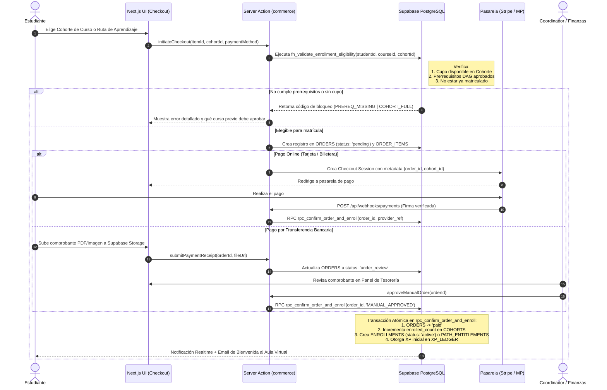
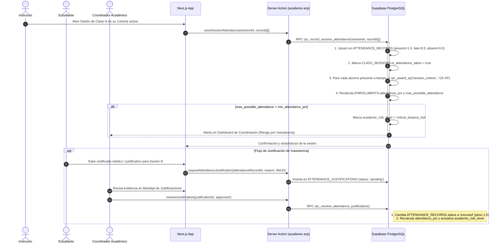
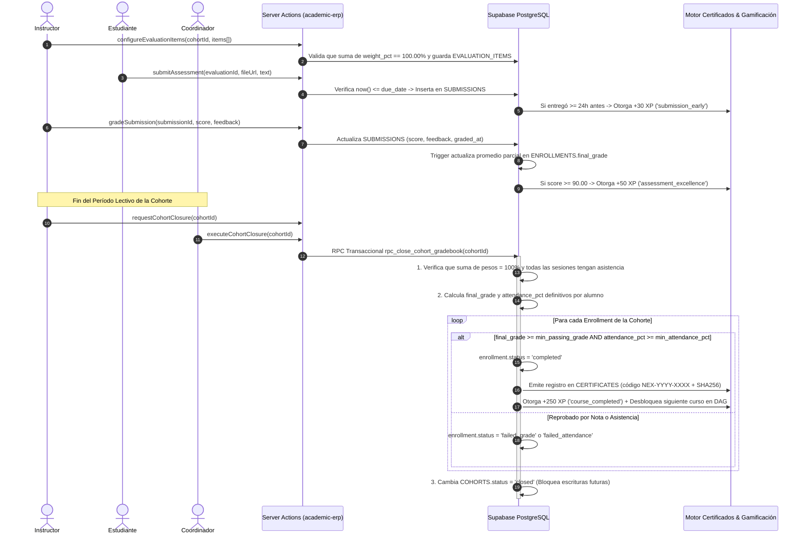
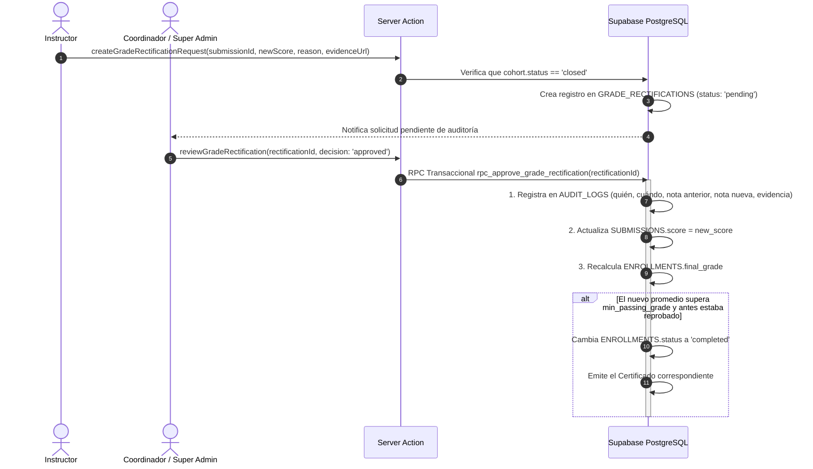
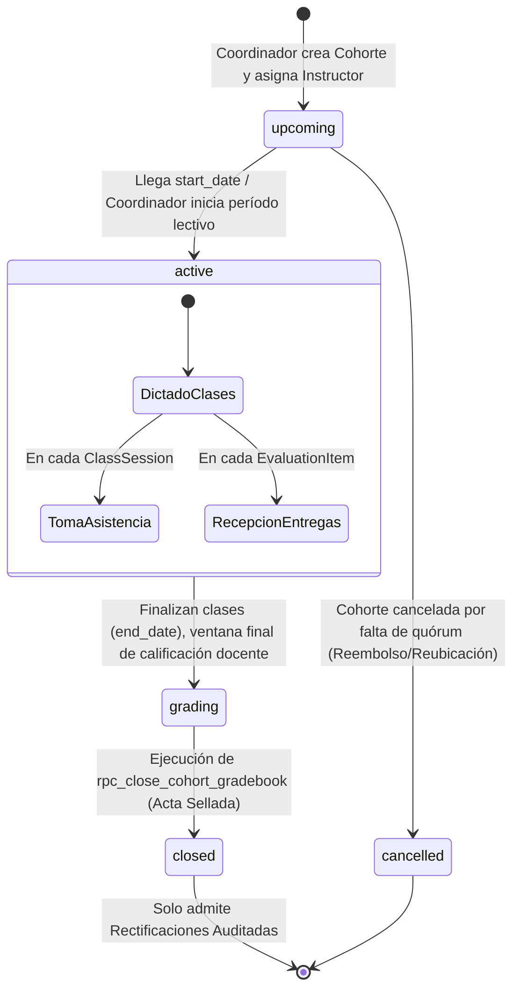
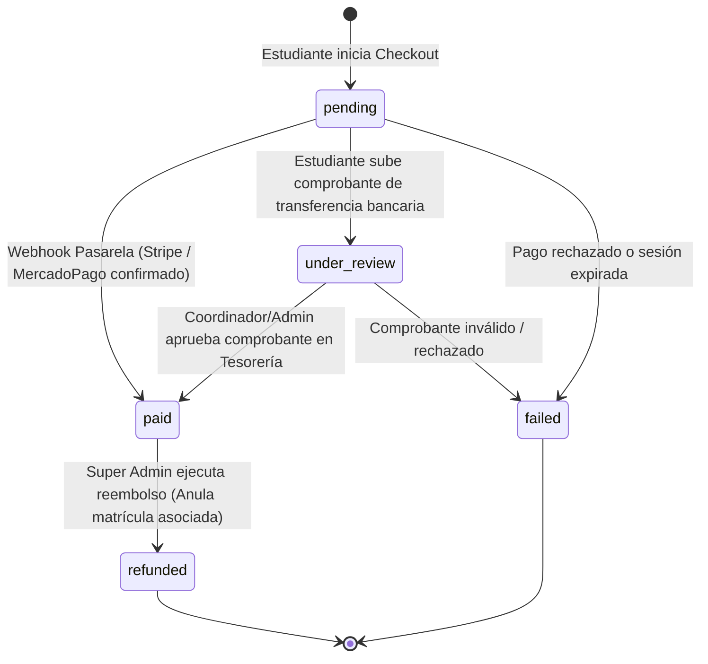

# 04 — Diagramas de Procesos de Negocio y Máquinas de Estado

> **Propósito de este documento**: Modelar todos los procesos operativos, comerciales y académicos de **Nexus** mediante diagramas de secuencia detallados y diagramas de máquinas de estado (`Statecharts`). Estos diagramas son el plano directo para programar los casos de uso y funciones RPC en las Fases 2 a 6.

---

## 1. Proceso 1: Compra Individual (Curso o Ruta) -> Activación de Matrícula

Cubre tanto el flujo automático por pasarela (Stripe/MercadoPago) como el flujo institucional por comprobante bancario o uso de crédito de ruta previamente adquirida.

---

## 2. Proceso 2: Toma de Asistencia, Cálculo de Riesgo y Justificaciones

Describe cómo interactúan el **Instructor**, el **Estudiante** y el **Coordinador** en el control de asistencia de cada sesión de clase y cómo se dispara el sistema de alerta temprana de deserción.

---

## 3. Proceso 3: Evaluación, Calificación Ponderada, Cierre de Acta y Certificación

Modela el flujo completo desde que el instructor configura los rubros de evaluación ($\sum w_i = 100\%$), los alumnos entregan, el instructor califica y finalmente se cierra el acta de la cohorte disparando los certificados.

---

## 4. Proceso 4: Rectificación Auditada de Calificación en Acta Cerrada

En un ERP universitario real, un acta cerrada es sagrada, pero pueden existir errores materiales o reclamos válidos. Este flujo garantiza trazabilidad total:

---

## 5. Máquinas de Estado del Sistema (`Statecharts`)

### 5.1 Máquina de Estados de una Cohorte (`cohort_status`)

### 5.2 Máquina de Estados de una Orden de Compra (`order_status`)

