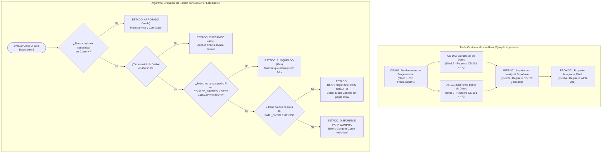
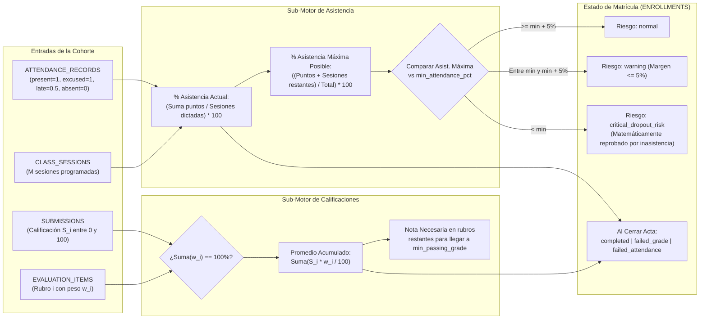
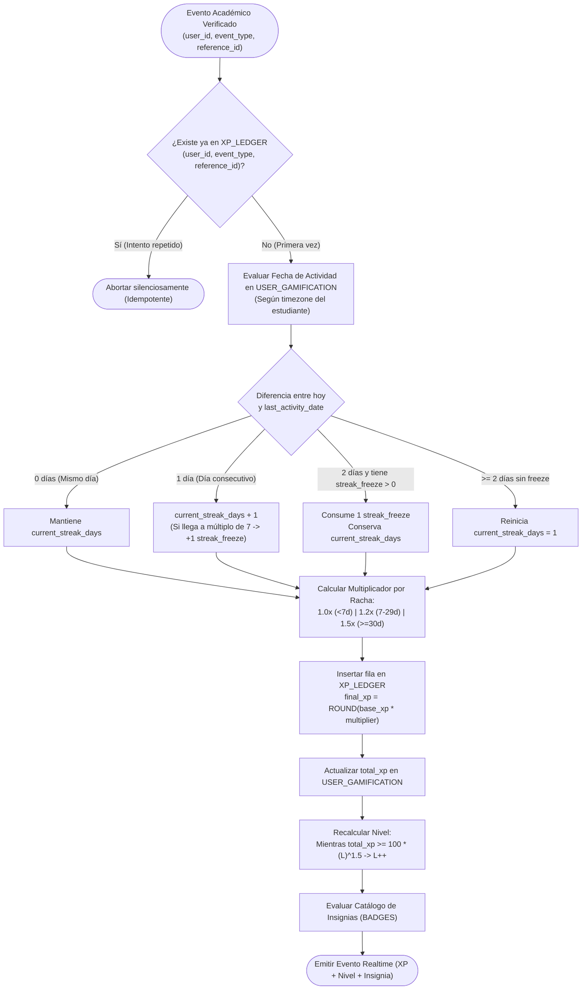
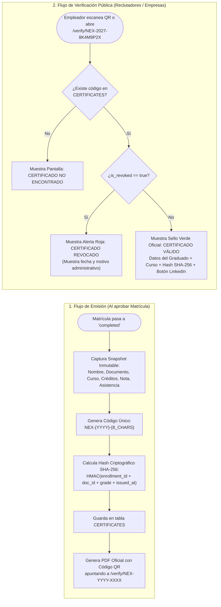

# 05 — Diagramas de Funcionalidad y Lógica Algorítmica de Motores

> **Propósito de este documento**: Especificar los diagramas de funcionalidad y la lógica algorítmica interna de los **4 Motores Principales de Nexus**:
> 1. Motor de Rutas de Aprendizaje y Prerrequisitos (DAG Engine)
> 2. Motor del Libro de Calificaciones Ponderado y Asistencia (ERP Engine)
> 3. Motor de Gamificación, Rachas e Insignias (Gamification Engine)
> 4. Motor de Emisión y Verificación Criptográfica de Certificados (Certificate Engine)

---

## 1. Motor 1: Rutas de Aprendizaje y Grafo de Prerrequisitos (DAG Engine)

En **Nexus**, una Ruta de Aprendizaje (`LearningPath`) no es una simple lista plana de videos; es una **malla curricular modelada como un Grafo Dirigido Acíclico (DAG)** donde cada nodo es un `Course` y las aristas dirigidas representan `course_prerequisites`.

### 1.1 Diagrama de Funcionalidad de Desbloqueo Curricular

### 1.2 Algoritmo de Detección de Ciclos al Configurar Prerrequisitos
Cuando un `coordinator` intenta agregar la regla *"El curso $B$ requiere aprobar previamente el curso $A$"* ($A \to B$):
1. Si $A == B$, se rechaza inmediatamente (auto-referencia).
2. Se ejecuta una búsqueda en profundidad (DFS) o `WITH RECURSIVE` en SQL partiendo de $B$ para listar todos los cursos que dependen directa o indirectamente de $B$.
3. Si $A$ aparece en el conjunto de descendientes de $B$, agregar $A \to B$ formaría un ciclo cerrado ($A \to \dots \to B \to A$), por lo que el motor rechaza la operación con el error `DAG_CYCLE_DETECTED`.

---

## 2. Motor 2: Libro de Calificaciones Ponderado y Control de Asistencia (ERP Engine)

### 2.1 Diagrama Funcional del Cálculo Académico en Tiempo Real

### 2.2 Especificación Matemática del Dictamen al Cierre de Acta
Sea:
- $G_{\text{min}}$ la nota mínima aprobatoria del curso (`courses.min_passing_grade`, ej. `70.00`).
- $A_{\text{min}}$ el porcentaje mínimo de asistencia del curso (`courses.min_attendance_pct`, ej. `80.00`).
- $G_{\text{final}}$ la nota final ponderada redondeada a 2 decimales.
- $A_{\text{final}}$ el porcentaje de asistencia sobre el total de sesiones dictadas en la cohorte.

Al ejecutar el cierre de acta, la función determinística asigna:
1. Si $A_{\text{final}} < A_{\text{min}} \implies \text{status} = \texttt{'failed\_attendance'}$ (Reprobado por inasistencia, independientemente de la nota).
2. Si $A_{\text{final}} \ge A_{\text{min}} \land G_{\text{final}} < G_{\text{min}} \implies \text{status} = \texttt{'failed\_grade'}$ (Reprobado por calificación).
3. Si $A_{\text{final}} \ge A_{\text{min}} \land G_{\text{final}} \ge G_{\text{min}} \implies \text{status} = \texttt{'completed'}$ (Aprobado $\to$ Dispara Certificado y XP).

---

## 3. Motor 3: Gamificación Anti-Farming (XP, Rachas, Niveles e Insignias)

### 3.1 Diagrama de Funcionalidad del Pipeline de Gamificación

### 3.2 Catálogo Inicial de Insignias (`BADGES`) Automáticas

| Código (`code`) | Nombre de la Insignia | Condición Lógica de Desbloqueo | Bono XP |
| :--- | :--- | :--- | :-: |
| `FIRST_STEP` | **Primer Paso Académico** | Completar la primera lección de cualquier curso. | `+50 XP` |
| `STREAK_7` | **Constancia de Acero (7 Días)** | Alcanzar `current_streak_days >= 7`. | `+100 XP` |
| `STREAK_30` | **Hábito Maestro (30 Días)** | Alcanzar `current_streak_days >= 30`. | `+500 XP` |
| `PERFECT_ATTENDANCE` | **Asistencia Perfecta** | Aprobar una cohorte cerrada con `attendance_pct == 100.00%`. | `+200 XP` |
| `HONOR_ROLL` | **Cuadro de Honor (`Magna Cum Laude`)** | Aprobar una cohorte cerrada con `final_grade >= 95.00`. | `+300 XP` |
| `PATH_GRADUATE` | **Graduado de Programa Completo** | Aprobar todos los cursos obligatorios de un `LearningPath`. | `+1000 XP` |

---

## 4. Motor 4: Emisión y Verificación de Certificados (`Certificate Engine`)

### 4.1 Diagrama de Funcionalidad de Emisión y Verificación Pública

