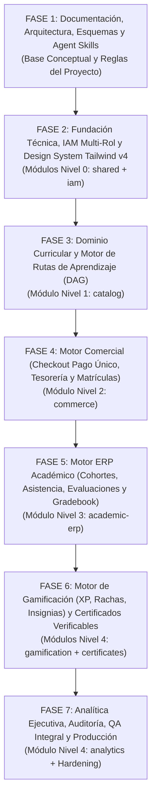

# 06 — Roadmap de Ingeniería por Fases (Plan de Ejecución Multi-Mes)

> **Propósito de este documento**: Estructurar la construcción de **Nexus** en **7 Fases Secuenciales y Modulares**. Dado que es un proyecto de varios meses de envergadura, cada fase entrega un bloque funcional completo, probado y desplegable sin romper las fases anteriores, siguiendo estrictamente el grafo de dependencias (Nivel 0 $\to$ Nivel 4).

---

## 1. Mapa Visual de Fases del Proyecto

---

## 2. Desglose Detallado de Cada Fase y Criterios de Aceptación (*Definition of Done*)

### [Completado] FASE 1: Arquitectura, Modelo de Negocio, Esquemas, Diagramas y Skills *(Fase Actual)*
- **Objetivo**: Dejar completamente documentada la arquitectura, el modelo de negocio, el esquema de 24 tablas, los diagramas de secuencia/estado/funcionalidad, el sistema de diseño y las Skills de IA en el repositorio antes de escribir una sola línea de código de aplicación.
- **Entregables**:
  - [`README.md`](../README.md) y [`AGENTS.md`](../AGENTS.md) en la raíz del proyecto.
  - 6 Skills especializadas en [`.agents/skills/`](../.agents/skills/).
  - Documentos `00` al `07` en [`/docs`](./).

---

### [Completado y Verificado en Supabase] FASE 2: Fundación Técnica, Autenticación Multi-Rol (IAM) y Design System (Nivel 0)
- **Objetivo**: Inicializar el repositorio con **Next.js (App Router) + React + TypeScript + Tailwind CSS v4 + Supabase**, configurar el sistema de diseño base y dejar funcionando la autenticación y autorización real en Supabase para los 4 roles (`super_admin`, `coordinator`, `instructor`, `student`).
- **Módulos involucrados**: `src/shared/`, `src/modules/iam/`.
- **Tablas SQL migradas en `ttywzvvemkydfuflsoxy`**: `profiles`, `user_roles`, `audit_logs` + funciones helper RLS (`current_user_role()`, `is_admin_or_coordinator()`, `is_super_admin()`, `rpc_assign_user_role()`).
- **Estado Real Verificado (Deducción desde Hechos)**:
  - [x] Código base Next.js + TypeScript estricto + Tailwind CSS v4 (`@theme` Luminous Alabaster, Liquid Platinum & Obsidian Ink) inicializado y compilando.
  - [x] Proyecto real **`Nexus` (`id: ttywzvvemkydfuflsoxy`)** creado y activo (`ACTIVE_HEALTHY`) en `us-east-1`.
  - [x] Archivo `.env.local` configurado con la URL y llaves reales del proyecto.
  - [x] Migraciones `20261117030304_phase2_iam_and_core` y `20261117030424_phase2_security_and_rls_hardening` aplicadas en PostgreSQL 17.
  - [x] Auditoría de `get_advisors` ejecutada (`pg_trgm` movido al esquema `extensions`, permisos `EXECUTE` revocados para `anon` y funciones trigger internas blindadas).
  - [x] Tipos TypeScript reales generados desde Supabase en `src/shared/types/database.types.ts` y conexión empírica verificada con `npm run db:verify`.

---

### [Completado y Verificado en Supabase] FASE 3: Dominio Curricular — Catálogo de Cursos y Motor de Rutas DAG (Nivel 1)
- **Objetivo**: Construir toda la gestión académica de cursos, módulos, lecciones, períodos académicos y el constructor visual de **Rutas de Aprendizaje con Prerrequisitos (DAG)**.
- **Módulos involucrados**: `src/modules/catalog/`.
- **Tablas SQL migradas en `ttywzvvemkydfuflsoxy`**: `academic_terms`, `learning_paths`, `courses`, `learning_path_items`, `course_prerequisites`, `course_modules`, `lessons`.
- **Estado Real Verificado (Deducción desde Hechos)**:
  - [x] Las 7 tablas de Nivel 1 existen en PostgreSQL 17 con `rls_enabled: true`, índices cubrientes (`INCLUDE`), parciales (`WHERE is_published = true`) y GIN Trigram (`extensions.gin_trgm_ops`).
  - [x] Función recursiva CTE `public.enforce_dag_no_cycles()` y trigger `trg_enforce_dag_no_cycles` creados y probados en vivo (rechaza cualquier intento de dependencia circular con `DAG_CYCLE_DETECTED`).
  - [x] Datos reales sembrados en PostgreSQL (`3` períodos académicos, `6` rutas/facultades, `5` cursos troncales `CS-101` a `ERP-401`, `6` aristas de prerrequisitos DAG, módulos y lecciones).
  - [x] Módulo `src/modules/catalog/` implementado bajo arquitectura limpia y conectado en vivo a `/` y `/paths`.

---

### [Completado y Verificado en Supabase] FASE 4: Motor Comercial — Checkout de Pago Único, Tesorería y Matrículas (Nivel 2)
- **Objetivo**: Permitir que los estudiantes compren cursos individuales o rutas completas (pago en línea o transferencia bancaria verificada) y queden matriculados en una cohorte con control de cupos.
- **Módulos involucrados**: `src/modules/commerce/`.
- **Tablas SQL migradas en `ttywzvvemkydfuflsoxy`**: `cohorts`, `coupons`, `orders`, `order_items`, `path_entitlements`, `enrollments`.
- **Estado Real Verificado (Deducción desde Hechos)**:
  - [x] Las 6 tablas de Nivel 2 existen en PostgreSQL 17 (`ttywzvvemkydfuflsoxy`) con `rls_enabled: true`, índices cubrientes (`INCLUDE`), parciales y restricciones de integridad financiera y de cupos (`chk_cohorts_capacity`).
  - [x] Función RPC en PostgreSQL `public.fn_check_cohort_enrollment_eligibility(p_student_id, p_cohort_id)` creada y probada en vivo: autoriza ingreso directo en cursos raíz (`CS101-2027I-A`) y bloquea con `PREREQUISITES_MISSING` en cursos cuyos prerrequisitos DAG aún no han sido aprobados (`DB102-2027I-A`).
  - [x] Sembradas `6` cohortes reales en el período `2027-I` y `3` cupones/becas (`NEXUS20`, `EARLY2027`, `BECA100`).
  - [x] Módulo `src/modules/commerce/` implementado bajo arquitectura limpia y conectado en vivo a `/commerce`.

---

### [Completado y Verificado en Supabase] FASE 5: Motor ERP Académico — Asistencia, Evaluaciones, Gradebook y Actas (Nivel 3)
- **Objetivo**: Construir el corazón operativo universitario/escolar para profesores, coordinadores y estudiantes: aula virtual, sesiones de clase, asistencia con alerta temprana, entregas, libro de calificaciones ponderado y cierre/rectificación de actas.
- **Módulos involucrados**: `src/modules/academic-erp/`.
- **Tablas SQL migradas en `ttywzvvemkydfuflsoxy`**: `class_sessions`, `attendance_records`, `attendance_justifications`, `evaluation_items`, `submissions`, `grade_rectifications`, `lesson_progress`.
- **Estado Real Verificado (Deducción desde Hechos)**:
  - [x] Las 7 tablas de Nivel 3 existen en PostgreSQL 17 (`ttywzvvemkydfuflsoxy`) con `rls_enabled: true`, todas las claves foráneas indexadas e índices cubrientes (`INCLUDE`).
  - [x] Triggers de inmutabilidad en actas cerradas (`trg_immutable_evaluation_items_on_closed`, `trg_immutable_submissions_on_closed`, `trg_immutable_attendance_on_closed`) y función RPC `public.fn_get_cohort_erp_audit(p_cohort_id)` creados y probados en vivo: valida $\sum w_i = 100.00\%$ en `CS101-2027I-A` y `DB102-2027I-A`, y bloquea el cierre de acta en `SEC201-2027I-A` ($\sum w_i = 70.00\%$).
  - [x] Sembradas `9` sesiones de clase sincrónicas y `9` rubros evaluativos ponderados reales en PostgreSQL.
  - [x] Módulo `src/modules/academic-erp/` implementado bajo arquitectura limpia y conectado en vivo a `/erp`.

---

### [Completado y Verificado en Supabase] FASE 6: Motor de Gamificación y Certificados Verificables (Nivel 4)
- **Objetivo**: Elevar la retención estudiantil mediante el motor de experiencia (`xp_ledger`), niveles, rachas diarias con protectores, insignias y la emisión/verificación pública de certificados.
- **Módulos involucrados**: `src/modules/gamification/`, `src/modules/certificates/`.
- **Tablas SQL migradas en `ttywzvvemkydfuflsoxy`**: `user_gamification`, `xp_ledger`, `badges`, `user_badges`, `certificates`.
- **Estado Real Verificado (Deducción desde Hechos)**:
  - [x] Las 5 tablas de Nivel 4 existen en PostgreSQL 17 (`ttywzvvemkydfuflsoxy`) con `rls_enabled: true`, restricción compuesta anti-farming `uq_xp_ledger_idempotent` (`UNIQUE (user_id, event_type, reference_id)`) e índice cubriente $O(\log n)$ `idx_certificates_verification_lookup`.
  - [x] Funciones PostgreSQL `public.fn_calculate_level_from_xp(p_total_xp)` y `public.fn_verify_certificate_by_code(p_verification_code)` creadas y probadas en vivo para los 3 estados (`VALID`, `REVOKED` y `NOT_FOUND`).
  - [x] Sembradas `6` insignias de mérito académico en `public.badges` y `4` certificados con hash criptográfico SHA-256 generado con `extensions.digest(..., 'sha256')` en `public.certificates`.
  - [x] Módulos `src/modules/gamification/` y `src/modules/certificates/` implementados bajo arquitectura limpia y conectados a `/verify`, `/verify/[code]` y `/profile`.

---

### [Completado y Verificado en Supabase] FASE 7: Analítica Ejecutiva, Auditoría, Pruebas E2E y Lanzamiento (Nivel 4)
- **Objetivo**: Construir los tableros de inteligencia de negocio y control académico, realizar pruebas de verificación deductiva E2E sobre las 28 tablas y funciones RPC en Supabase PostgreSQL, y dejar la compilación lista para despliegue productivo.
- **Módulos involucrados**: `src/modules/analytics/`.
- **Estado Real Verificado (Deducción desde Hechos)**:
  - [x] Función RPC ejecutiva `public.fn_get_executive_analytics_snapshot()` desplegada en PostgreSQL 17 (`ttywzvvemkydfuflsoxy`) consolidando en tiempo real métricas curriculares, financieras/cupos, sesiones/evaluaciones ERP, insignias y certificados SHA-256.
  - [x] Módulo `src/modules/analytics/` implementado bajo arquitectura limpia y conectado en vivo a `/analytics`.
  - [x] Suite de verificación deductiva E2E (`npm run db:verify` en `scripts/verify-supabase.mjs`) validando las 28 tablas con RLS activo y ejecutando aserciones reales (`node:assert/strict`) sobre las funciones RPC de PostgreSQL.

---

## 3. Fases de Endurecimiento Productivo en Operación Real (*Real-Operation Production Hardening*)

Tras completar las 7 fases fundacionales, **Nexus** incorpora una capa de endurecimiento operativo en PostgreSQL y Next.js App Router para garantizar operación real sin datos simulados ni estados inconsistentes:

1. **Política Zero-Hardcode y Estado Real en Base de Datos**:
   - Eliminación de catálogos, contadores, matrículas o notificaciones hardcodeadas en la interfaz o en memoria; toda vista lee y muta directamente contra PostgreSQL con RLS activo.
   - Script reproducible de reinicio limpio [`supabase/reset_clean.sql`](../supabase/reset_clean.sql) para restablecer el esquema y los datos operativos verificados sin residuos de prueba.
2. **Sistema de Notificaciones Persistentes (`notifications`)**:
   - Tabla `public.notifications` protegida con RLS por usuario, conectada al Drawer de Notificaciones en tiempo real con conteo de no leídas, filtrado por categoría y marcado transaccional de lectura.
3. **RPCs Atómicas Transaccionales (`PL/pgSQL`)**:
   - `rpc_confirm_order_and_enroll`: Confirma el pago de una orden y activa atómicamente la matrícula (`enrollments`) validando cupos disponibles y prerrequisitos DAG.
   - `rpc_approve_pending_order`: Permite a `super_admin` o `coordinator` aprobar órdenes pendientes (ej. transferencia bancaria) con registro de auditoría y activación de matrícula.
   - `rpc_close_cohort_gradebook`: Verifica el invariante $\sum w_i = 100.00\%$ de los rubros de evaluación, consolida promedios finales/asistencia y sella la cohorte en estado `closed`.
   - `rpc_award_xp_idempotent`: Otorga experiencia en `xp_ledger` bajo la clave única `(user_id, event_type, reference_id)` evitando duplicación de puntos y recalculando el nivel en `user_gamification`.
   - `rpc_issue_certificate_on_completion`: Emite certificados verificables con hash criptográfico SHA-256 únicamente cuando se cumple la conjunción de nota mínima, asistencia mínima y orden en estado `paid`.
