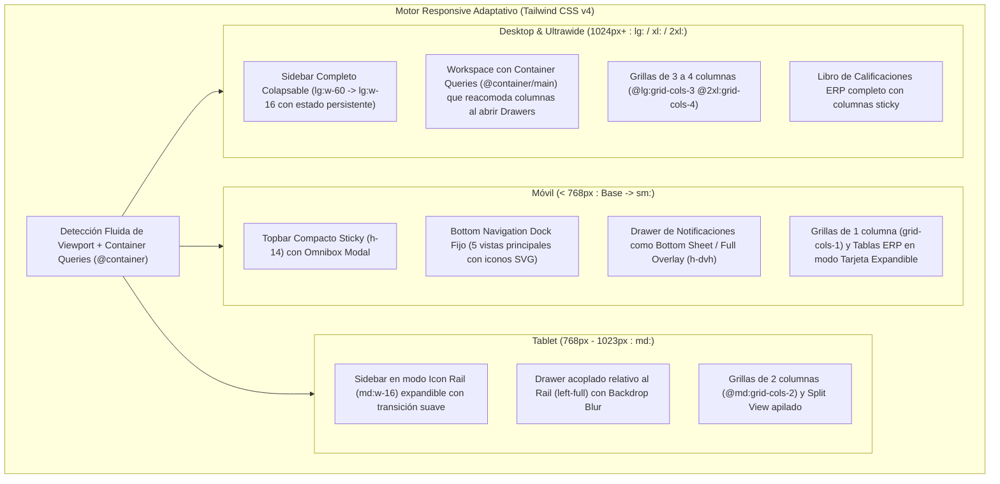

# 07 — Sistema de Diseño, Arquitectura Responsive y UX Interactiva (Obsidian & Neon Silver)

> **Propósito de este documento**: Definir la identidad visual **Obsidian Black & Plateado Neón (Liquid Chrome)**, el sistema de **iconografía vectorial moderna (Cero Emojis)**, la **arquitectura responsive fluida multi-dispositivo en Tailwind CSS v4 (sin valores hardcoded)** y los patrones de **interactividad dinámica** de **Nexus**.

---

## 1. Filosofía Visual y Regla "Cero Emojis"

Para proyectar una imagen tecnológica de primer nivel que supere los estándares de la industria:

1. **Política Estricta de Cero Emojis (`Zero-Emoji Standard`)**:
   - Queda prohibido el uso de emojis del sistema en cualquier pantalla, tarjeta, alerta, insignia o menú. Los emojis se renderizan distinto en Windows, macOS, iOS y Android, rompiendo la estética premium.
   - **Iconografía Vectorial Unificada**: Se utiliza `lucide-react` complementado con emblemas SVG geométricos personalizados (`viewBox="0 0 24 24"`, `fill="none"`, `stroke="currentColor"`, `stroke-width="1.75"`, `stroke-linecap="round"`, `stroke-linejoin="round"`).
   - **Acabado Neón en Iconos**: Los íconos de escuelas, rachas y estados activos utilizan trazos en blanco/plata (`#F8FAFC`) sobre contenedores de cristal oscuro (`bg-white/[0.04] border border-white/15`) con efecto `drop-shadow(0 0 8px rgba(226, 232, 240, 0.4))`.

2. **Sistema Cromático "Obsidian Black & Electric Neon Silver"**:
   - **Fondos Oscuros Profundos**:
     - `--color-obsidian-950` (`#050608`): Fondo base del canvas con foco ambiental superior radial en platino.
     - `--color-obsidian-900` (`#090B0E`): Superficie estructural para Sidebar, Topbar y Bottom Dock móvil.
     - `--color-obsidian-800` (`#101319`): Superficie de tarjetas con borde sutil `border-white/[0.07]`.
     - `--color-obsidian-700` (`#161B24`): Superficie elevada en estado `hover` o elemento seleccionado.
   - **Acento Plateado Neón (`Liquid Chrome`)**:
     - Gradiente metálico principal: `bg-gradient-to-b from-white via-slate-100 to-slate-300 text-[#050608]`.
     - Halo luminoso: `shadow-[0_0_22px_-2px_rgba(226,232,240,0.35),0_0_8px_0_rgba(186,230,253,0.22),inset_0_1px_0_0_rgba(255,255,255,0.9)]`.

---

## 2. Arquitectura Responsive Fluida en Tailwind CSS v4 (Sin Hardcoding)

La interfaz de **Nexus** no usa anchos ni posiciones fijas rígidas (`hardcoded`) que rompan la experiencia en pantallas pequeñas, tablets o monitores ultrawide. Se construye mediante **Flexbox/Grid relativo**, **Variables CSS dinámicas** y **Container Queries (`@container`)** nativas de Tailwind v4.

### 2.1 Patrones Técnicos de Tailwind v4 para Evitar el Hardcoding

| Problema Común (Hardcoded) | Solución Arquitectónica en Nexus (Tailwind v4) |
| :--- | :--- |
| Posicionar el Drawer de Notificaciones con `left-[235px]` fijo (se rompe en móvil o al colapsar el sidebar). | Contenedor padre `relative flex` donde el Sidebar define el flujo y el Drawer usa `fixed inset-0 z-50 md:absolute md:inset-y-0 md:left-full md:w-88 lg:w-96`. Así, si el sidebar mide `4rem` (colapsado) o `15rem` (expandido), `md:left-full` lo acopla exactamente al borde derecho sin un solo píxel hardcodeado. |
| Usar solo `@media (min-width)` para las tarjetas de escuelas (se aplastan cuando se abre un panel lateral). | Declarar el área principal como `@container/workspace` y usar clases de **Container Query**: `grid grid-cols-1 @sm/workspace:grid-cols-2 @xl/workspace:grid-cols-3 @4xl/workspace:grid-cols-4 gap-3.5`. |
| Usar `100vh` que se corta con la barra de direcciones en navegadores móviles (Safari/Chrome iOS/Android). | Usar siempre unidades dinámicas de viewport de Tailwind v4: `min-h-dvh` y `h-dvh`, más `pb-[env(safe-area-inset-bottom)]` en el Bottom Dock móvil. |
| Tipografías gigantes que desbordan en pantallas de `360px` de ancho. | Escala tipográfica responsiva fluida: `text-lg sm:text-xl lg:text-2xl` y truncado inteligente (`min-w-0 truncate`, `line-clamp-2`). |

---

## 3. Interactividad Dinámica y Experiencia de Usuario Intuitiva

Nexus está diseñado para sentirse instantáneo, vivo y sumamente intuitivo en cada interacción:

### 3.1 Sistema de Interacciones en Tiempo Real
1. **Omnibox & Command Palette (`⌘K` / `Ctrl+K`)**:
   - Al hacer clic en el buscador superior o presionar `⌘K`, se abre una paleta de comandos flotante con filtrado instantáneo por teclado (`↑` `↓` `Enter` `Esc`).
   - Busca simultáneamente en **Escuelas**, **Rutas DAG**, **Cursos**, **Acciones Rápidas del ERP** (*"Consultar mi Kardex"*, *"Subir justificativo de asistencia"*) y el **Asistente IA**.
2. **Filtrado Reactivo y Conmutación Instantánea**:
   - En la vista **Inicio / Escuelas**, el usuario puede escribir para filtrar facultades en tiempo real o desplegar el acordeón animado de **Nuevos Lanzamientos y Cohortes Abiertas**.
   - En el **Drawer de Notificaciones**, las píldoras (`Todas`, `Sin leer`, `Académico`, `Lanzamientos`) filtran los eventos instantáneamente con contador dinámico de no leídos y botón de *"Marcar todas como leídas"*.
3. **Gráficas y Simuladores Académicos Interactivos**:
   - En **Mi Progreso y Kardex**, pasar el cursor o tocar cada barra de la semana muestra el detalle exacto de clases vistas, minutos estudiados y puntos XP ganados ese día.
   - En **Aula & ERP Académico**, el estudiante cuenta con un **Simulador Interactivo de Nota Final**: puede deslizar un control sobre sus evaluaciones pendientes (ej. *Proyecto Final*) para ver en vivo cómo impactará su promedio ponderado final y qué nota mínima necesita para aprobar y desbloquear su certificado.

---

## 4. Anatomía de las 4 Vistas Principales (Diseño Vectorial & Responsive)

### 4.1 Inicio y Explorador de Facultades (`/`)
- **Banner de Convocatoria Académica con Countdown en Vivo**: Diseño adaptativo (`flex-col lg:flex-row`) con reloj regresivo funcional segundo a segundo y CTA en Plateado Neón.
- **Separador Interactivo de Novedades**: Píldora central `7 nuevas cohortes y cursos lanzados` que al hacer clic despliega suavemente las tarjetas de estreno.
- **Grilla Adaptativa de Escuelas (`@container`)**: Tarjetas con emblema vectorial SVG de alto contraste, indicador de rutas de aprendizaje y cohortes activas, y filtro de búsqueda instantáneo.

### 4.2 Mi Progreso, Kardex ERP y Posición Semanal (`/student/progress`)
- **Layout Responsivo**: En móvil y tablet se apila verticalmente (`grid-cols-1`); en escritorio se distribuye en proporción `xl:grid-cols-12` (`8 columnas` para la gráfica semanal interactiva + tarjetas de Kardex ERP y `4 columnas` para el Leaderboard semanal de la cohorte).
- **Indicadores con Iconos SVG de Precisión**: Racha activa, promedio ponderado (`0-100`), porcentaje de asistencia con barra de umbral mínimo (`80%`) y ranking con indicadores vectoriales de ascenso.

### 4.3 Perfil Verificable del Estudiante (`/u/[username]`)
- **Banner Geométrico Cromo**: Composición vectorial en capas plateadas y obsidiana que se adapta a cualquier relación de aspecto.
- **Cabecera Responsiva**: Avatar superpuesto con insignia de nivel, acciones adaptativas (`w-full sm:w-auto`) para `Editar perfil` y `Compartir perfil verificable` (con copiado interactivo de enlace y vista previa para reclutadores), más grilla responsiva (`grid-cols-2 sm:grid-cols-3 lg:grid-cols-5`) de métricas académicas y certificados SHA-256.

### 4.4 Libro de Calificaciones y Simulador ERP (`/student/erp` & `/instructor/gradebook`)
- Desglose de rubros ponderados ($\sum w_i = 100\%$), control de asistencia por sesión con estados vectoriales claros y simulador interactivo de proyección de nota final.
